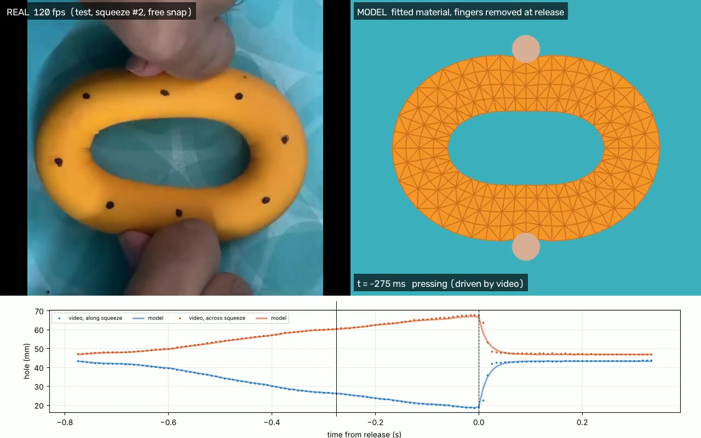

# Learning a rubber grip ring from video

I used a Decathlon "25 kg" hand-grip ring (75 g, 86 mm across, 21 mm tall). I lay it flat on a table, squeeze it with my thumb and finger, hold, and let go. I filmed it from above in slow motion (120 and 240 fps).

I then built a simple computer model of the ring and tuned it using the video. On a video the model never saw, it predicts the ring's shape while squeezed to within 0.2–0.4 mm, and how it springs back to within 1.3 mm.

**Live demo:** [add Vercel link]



## Running it

Everything is already computed. To see the demo:

```bash
cd viewer
python3 -m http.server 8000     # open http://localhost:8000
```

It needs internet (for three.js). `results/demo.mp4` shows the same thing as a normal video.

To rebuild everything from the raw videos:

```bash
pip install -r requirements.txt
python track.py --all    # measure the ring in every frame  (~1 min)
python fit.py            # tune the model                    (~5 min)
python evaluate.py       # test it on every squeeze          (~1 min)
python render.py         # make the demo video and website   (~30 s)
```

Videos are in `data/`. Frame rates, the train/test split and the ring's measurements are in `trials.json`.

## How it works

**1. Measuring the ring.** I find the orange ring by colour and fit an oval to its hole in every frame. I use the hole because my fingers never cover it. That gives two numbers per frame: how narrow the hole gets along the squeeze, and how wide it gets across it.

My ruler said the hole was 56 mm, but every video says 45 mm. With 45 mm, the ring's weight works out to the right density for rubber, so the ruler reading was wrong.

**2. Not every release is useful.** In 9 of my 11 squeezes, my fingers stayed on the ring while it opened, so the video shows my hand's speed, not the rubber's. In only 2 did my finger slip off and the ring spring back on its own (in about 20 ms). One is in the training videos and one in the test video. Only these show how "bouncy" the rubber is.

**3. The model.** The ring is squeezed flat on the table, so I modelled it in 2D: the ring's outline split into 384 small triangles (a finite-element model), with the ring's real weight. Each triangle acts like a spring (stiffness) plus a shock absorber (damping). The fingertips are two round pads that push but can't pull, and grip the rubber.

The rubber is very heavily damped, which makes simple simulation methods unstable unless the time steps are tiny. So I used a more stable method (implicit Euler). One squeeze takes about 3 seconds to simulate.

**4. Not just copying the video.** While I'm pressing, the model's fingers follow the video. The moment I let go, the fingers are removed and the ring moves only by its own physics. How wide the hole gets during the press is never given to the model either; it works that out itself.

**5. Tuning the model.**
- **Shape while squeezed:** checks the geometry. Matches the training videos to 0.68 mm.
- **Spring-back after a snap:** sets the damping. The time constant is 16.5 ms.
- **Stiffness:** the video can't tell it apart from damping. A stiffer, more damped ring and a softer, less damped one spring back the same way. So I took stiffness from the "25 kg" rating instead: 3.3 MPa, normal for rubber.

## Results

The test video (3 squeezes) was never used for tuning:

| test squeeze | release | shape error | spring-back error |
|---|---|---|---|
| 1 | fingers stayed on | 0.31 mm | 5.4 mm |
| 2 | fingers stayed on | 0.15 mm | 4.3 mm |
| 3 | finger slipped off | 0.43 mm | 1.34 mm |

- The shape while squeezed is right to under 1 mm every time.
- On the real snap (squeeze 3), the spring-back is right to 1.34 mm, about the same as on the training snap (1.14 mm).
- On squeezes 1 and 2 the model springs back faster than the real ring. That's expected: my fingers were slowing the real one down.

All 11 squeezes are in `results/metrics.md`.

## Assumptions

- The ring only deforms flat (2D). The 3D ring on the website is the 2D result wrapped onto the ring's shape.
- The rubber is the same everywhere.
- The fingertips are rigid and let go instantly.
- "25 kg" is the force needed to squeeze the hole shut.
- The camera looks straight down.

## Limitations

- **Stiffness isn't measured from the video.** Squeezing the ring on a kitchen scale would fix this.
- **Very hard squeezes break the model.** Past about 30 mm the real hole flattens into a slit; the model can't do that.
- **The start of the snap is a bit off.** The real ring starts slowly while my finger slides off, then speeds up. The model starts at full speed.
- **Damping comes from only 2 snaps,** so it may include a little hand movement.
- **A top-down view can't show** how much the ring bulges upwards, or slow creep over long holds.

## Credits

OpenCV, NumPy, SciPy, Numba, Matplotlib, pandas, three.js and FFmpeg. The simulation method follows Baraff & Witkin (1998) and Müller & Gross (2004).
